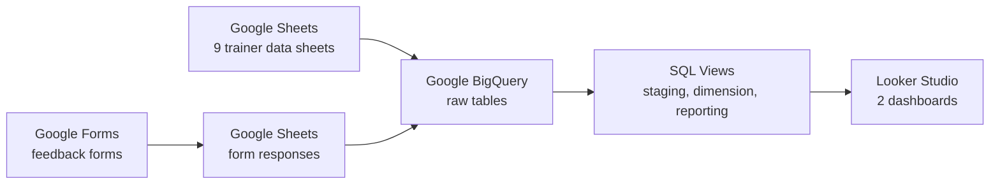

# Trainer Analytics Pipeline

An end-to-end data analytics project that takes raw data from **Google Forms and Google Sheets**, moves it into **Google BigQuery**, cleans and organises it with **SQL views**, and presents it in **Looker Studio**.

The project has two dashboards, built as one Looker Studio report:

1. **Trainer Performance Analytics Dashboard**: attendance, demos, teaching hours, batches, and student outcomes.
2. **Session Feedback Analytics Dashboard**: student ratings and comments for every trainer, collected through Google Forms.

> **Note:** All data in this project is dummy data, created for learning and portfolio purposes.

---

## Tools Used

| Tool | What I used it for |
|---|---|
| Google Forms | Collecting session feedback from students |
| Google Sheets | Storing and organising the raw data |
| Google BigQuery | Storing the data and running SQL on it |
| SQL | Cleaning, joining, and summarising the data |
| SQL Views | Creating reusable, ready-to-use data layers |
| Looker Studio | Building the dashboards |
| Google Cloud (IAM) | Managing project access and permissions |

---

## How the Whole Pipeline Works



In simple words:

- **Dashboard 1:** data starts in Google Sheets, goes to BigQuery, and is turned into views.
- **Dashboard 2:** data starts in Google Forms, lands in Google Sheets automatically, then goes to BigQuery and is turned into views.
- **Both dashboards** read only from the views in BigQuery, never from the raw sheets directly.

---

## First, What Are Data Views? (Important for Every Analyst)

A **view** is a saved SQL query that behaves like a table.

- A view **does not store its own copy of the data**. Every time someone opens it, it reads the latest data from the original tables. So the dashboard is always up to date.
- Analysts use views so that people downstream (like dashboard users) can **get only the columns and rows they need**, without touching or changing the original data.
- A view saves time. A query that is used again and again is written **once**, and everyone reuses it.
- Views keep the logic in **one place**. If a rule changes (for example, how we clean a name), we fix it in one view and every dashboard that uses it updates on its own.
- Views can also help with data security, since users can be given access to the view instead of the raw table. This works best when the view only exposes the columns people are allowed to see.

In this project I used views in **three layers**:

| Layer | What it does | Simple example |
|---|---|---|
| **Staging views** | Clean the raw data: remove blank rows, trim extra spaces, give columns clear names | `stg_attendance` |
| **Dimension views** | Lookup lists, such as trainers, batches, and modules, used to bring in readable names | `dim_trainer` |
| **Reporting views** | The final, ready-to-use views that Looker Studio connects to | `vw_group_a_trainer_performance` |

---

# Part 1: Trainer Performance Analytics Dashboard

**What it answers:** How is each trainer performing in attendance, demos, teaching hours, batches, and student outcomes, across branches?

### Step 1: Raw data in Google Sheets

The data was organised in **9 Google Sheets**:

- Attendance
- Trainer details
- Batch
- Demo
- Session (teaching hours)
- Student and trainer mapping
- Course and trainer mapping
- Placements
- Internships

### Step 2: Connecting Google Sheets to BigQuery

I linked each Google Sheet to **BigQuery** using Google Drive as the data source (BigQuery: Add data, then Google Drive). Each sheet became a table in a BigQuery dataset, so BigQuery could read the sheet's data directly.

### Step 3: Writing SQL and building views

I wrote SQL queries and saved them as **16 views**, in the exact order they were run:

1. **9 staging views** clean each raw table: trim text, remove blank rows, and rename columns.
2. **3 dimension views** (trainer, batch, module) give lookup lists for readable names.
3. **4 reporting views** feed the dashboard:
   - **Group A, Trainer Performance:** attendance, leaves, demos, and conversions per trainer per day
   - **Group B, Module and Session Hours:** teaching hours and students per session, module, and course
   - **Group C, Batch and Course Enrollment:** total, active, and dormant students per batch
   - **Group D, Student Outcomes:** which students were placed or interned

SQL used: `JOIN` (LEFT and FULL OUTER), `CASE WHEN`, `COALESCE`, `COUNT DISTINCT`, `COUNTIF`, `GROUP BY`, `TRIM`, and `LOWER`.

### Step 4: Dashboard in Looker Studio

I connected the reporting views to **Looker Studio** and built:

- **Filters:** Branch, Trainer, Course, Type, Mode, Module, and a date range
- **Attendance overview:** Present, Full Leave, Half Leave, Short Day
- **Demo KPIs:** Total Demo, Total Conversion, Reference, Reference Conversion
- **Module hours:** a donut chart showing share of teaching hours by module
- **Student numbers:** Total, Active, and Dormant students, batches, and total placed and interned
- **Tables and charts:** batch list with status, and online vs offline sessions

### What I learned from this part

- Placement and internship are **one-time events**, so those scorecards should not follow the page's date range. Otherwise they show "No data".
- Some views are built **one row per student or batch**, and others **one row per session**. Knowing this matters before adding up numbers, to avoid counting the same thing twice.

---

# Part 2: Session Feedback Analytics Dashboard

**What it answers:** How do students rate each trainer's sessions, and what do they suggest?

### Step 1: Collecting feedback with Google Forms

Each trainer has their **own Google Form**, and every form's responses go automatically into a linked **Google Sheet**.

Each form asks for the student's email and mobile number, then five ratings on a scale of **1 to 5**:

- Content Covered
- Task Discussion
- Pace of the Session
- Interaction and Engagement
- Overall Experience

Two open text questions follow: **suggestions** and **remarks**.

**Controlling the Branch and Trainer fields:** the dashboard filters by Branch and by Trainer, so these two values must be written exactly the same way in every response. I first used **data validation** on these two fields, but students still typed them in by hand, and one extra space created a "second" branch in the data. I fixed it at the source by changing both questions to **multiple choice**, with the options set by me, so students just click an option and every response is spelled identically.

### Step 2: Connecting Google Sheets to BigQuery

Every trainer's response sheet was loaded into **BigQuery** as its own table (one table per trainer).

### Step 3: Writing SQL and building views

Three views, run in this order:

1. **`stg_feedback_union`**: stacks every trainer's table on top of each other using `UNION ALL`, and renames the messy form column names into clean ones.
2. **`feedback_score_summary`**: calculates the **average** of each of the 5 ratings per trainer and branch, using `AVG()` and `GROUP BY`. This feeds the gauges.
3. **`feedback_comments`**: keeps only the rows where the student wrote a suggestion or remark. This feeds the table.

**Built to scale:** to add a new trainer, I only load their sheet and add **one more block** to `stg_feedback_union`. The other two views and the dashboard update on their own.

### Step 4: Dashboard in Looker Studio

- **5 gauge charts** (scale 1 to 5), one per rating
- **Branch and Trainer filters** that control all gauges and the table together
- **A comments table** with the student's name, suggestion, and remarks

### Problems I solved in this part

| Problem | Cause | Fix |
|---|---|---|
| Gauge showed 11.4 on a 1 to 5 scale | The chart was **adding** the averages instead of averaging them | Changed the metric from SUM to **AVG** |
| Filters did nothing on one page | A page-level issue in the report | Rebuilt the charts on a fresh page |
| One trainer appeared as two rows | An extra space typed into a form field | Switched the field to multiple choice |

---

## Challenge: Moving the Project to a New Google Cloud Account

While moving the project to a new account, I removed my own Owner role by mistake and was locked out of changing permissions. I learned to **always add a new permission and confirm it works before removing an old one**, and rebuilt the project cleanly in a new Google Cloud project.

---

## Repository Structure

```
trainer-analytics-pipeline/
├── README.md
├── data/
│   └── trainer_performance_sample_data.csv
├── sql/
│   ├── trainer_performance/
│   │   ├── 01_staging_views.sql
│   │   ├── 02_dimension_views.sql
│   │   ├── 03_group_a_trainer_performance.sql
│   │   ├── 04_group_b_module_session_hours.sql
│   │   ├── 05_group_c_batch_course_enrollment.sql
│   │   └── 06_group_d_student_outcomes.sql
│   └── session_feedback/
│       ├── 01_stg_feedback_union.sql
│       ├── 02_feedback_score_summary.sql
│       └── 03_feedback_comments.sql
└── dashboards/
    ├── trainer_performance_dashboard.pdf
    └── session_feedback_dashboard.pdf
```

## How to Run It Yourself

1. Create a BigQuery project and two datasets (for example, `trainer_performance` and `session_feedback`).
2. Load your Google Sheets into BigQuery as tables.
3. In every SQL file, replace `your-project-id` with your own project ID, and match the dataset names.
4. Run the SQL files **in number order** (01, then 02, and so on) for each dashboard.
5. Connect the reporting views to Looker Studio as data sources.

## Dashboard Previews


- Trainer Performance Analytics Dashboard: `dashboards/trainer_performance_dashboard.pdf`
- Session Feedback Analytics Dashboard: `dashboards/session_feedback_dashboard.pdf`

## Demo Video

*(Add your YouTube link here)*

## Skills Shown in This Project

SQL data transformation, joins and aggregations, data views (staging, dimension, and reporting layers), data cleaning, designing a pipeline that scales, BI dashboard design, form data validation, cloud access (IAM) troubleshooting.

## Author

**Mohammad Saad Khan**, Data Analytics
LinkedIn: *(add your link)*
